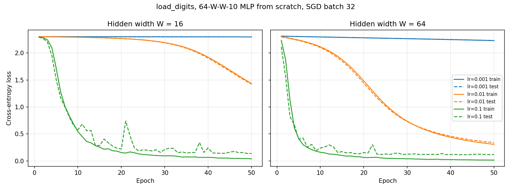

# Lab 02 — A neural network from scratch

## 1. Goal

Build a two-hidden-layer neural network in pure NumPy (no deep-learning framework), verify that the
hand-derived backpropagation is correct with a numerical gradient check, and compare how learning rate
and hidden width affect training, accuracy, and the cost of the forward and backward passes.

## 2. Method

- **Data:** `load_digits` (1,797 images of 8×8 digits). Pixels divided by 16 → [0, 1]; labels one-hot
  encoded; 70/30 stratified split, `random_state=42` → 1,257 train / 540 test.
- **Architecture:** 64 → W → ReLU → W → ReLU → 10 → softmax, for W = 16 and W = 64.

  | Layer | Weight shape | Bias shape | Params (W=16) | Params (W=64) |
  |---|---|---|---|---|
  | Hidden 1 | (64, W) | (W,) | 1,040 | 4,160 |
  | Hidden 2 | (W, W) | (W,) | 272 | 4,160 |
  | Output | (W, 10) | (10,) | 170 | 650 |
  | **Total** | | | **1,482** | **8,970** |

- **Initialisation:** weights ~ N(0, 0.01), read as N(mean, variance) → standard deviation 0.1; biases 0.
  With std = 0.01 the signal almost vanished through two layers (gradient check 7–8/10, near-chance accuracy),
  so variance 0.01 was used.
- **Loss:** mean cross-entropy. Backpropagation derived by hand with the chain rule
  (softmax + cross-entropy gives dL/dZ3 = (P − Y)/N; ReLU passes gradient only where Z > 0).
- **Gradient check:** 10 random weights per width, central difference with h = 1e-5, float64,
  relative error = |a − n| / (|a| + |n|); pass if < 1e-6 for at least 9 of 10.
- **Training:** mini-batch SGD, batch 32, 50 epochs, reshuffled every epoch, seed 42;
  learning rates {0.001, 0.01, 0.1} × widths {16, 64}.
- **Timing:** forward and backward timed separately, 1 warm-up then median of 100 runs,
  for a training batch (32) and the full test set (540).
- **Environment:** Python 3.11.8, NumPy 1.26.4, scikit-learn 1.5.0, Matplotlib 3.9.0, CPU only
  (`results/versions.txt`). Code: `src/`, run with `python lab02/src/run_all.py`.

## 3. Results

### Sanity checks (`results/sanity_checks.txt`)

| Check | W = 16 | W = 64 |
|---|---|---|
| Output shape | (1257, 10) ✓ | (1257, 10) ✓ |
| max \|row sum − 1\| | 3.3e-16 ✓ | 3.3e-16 ✓ |
| Untrained loss (ln 10 = 2.3026) | 2.3032 ✓ | 2.3128 ✓ |

### Gradient check (`results/gradient_check.csv`)

| Width | Passed (rel. error < 1e-6) | Result |
|---|---|---|
| 16 | 10 / 10 | **PASS** |
| 64 | 9 / 10 | **PASS** |

Typical relative errors were 1e-10 – 1e-7. The one failure (1.2e-6) is a weight with a very small gradient
(≈1e-5), where floating-point round-off in the finite difference matters most. Three sampled weights had
an exact zero gradient (inactive ReLU units) and pass trivially.

### Training (`results/training_results.csv`, `results/loss_curves.png`)

| Width | Learning rate | Final train loss | Final test loss | Train acc. | **Test acc.** |
|---|---|---|---|---|---|
| 16 | 0.001 | 2.2977 | 2.2983 | 0.1981 | **0.1778** |
| 16 | 0.01 | 1.4336 | 1.4207 | 0.6571 | **0.6556** |
| 16 | 0.1 | 0.0388 | 0.1372 | 0.9920 | **0.9648** |
| 64 | 0.001 | 2.2302 | 2.2314 | 0.3723 | **0.3574** |
| 64 | 0.01 | 0.3075 | 0.3356 | 0.9324 | **0.9130** |
| 64 | 0.1 | 0.0153 | 0.1171 | 0.9992 | **0.9685** |

### Timing (`results/timing.csv`, median of 100 runs, µs)

| Batch | Width | Forward | Backward | Backward / forward | Matmul MACs fwd | Matmul MACs bwd | MAC ratio |
|---|---|---|---|---|---|---|---|
| 32 | 16 | 35.5 | 35.0 | 0.99 | 46,080 | 59,392 | 1.29 |
| 32 | 64 | 51.7 | 66.7 | 1.29 | 282,624 | 434,176 | 1.54 |
| 540 | 16 | 387.6 | 299.1 | 0.77 | 777,600 | 1,002,240 | 1.29 |
| 540 | 64 | 884.6 | 1367.0 | 1.55 | 4,769,280 | 7,326,720 | 1.54 |

The forward pass does 3 matrix multiplications; the backward pass does 5 (dW for every layer plus dA for
the two hidden layers; dX is not needed). The input layer's dA is skipped, so backward does ~1.3–1.5× the
multiply-adds of forward rather than 2×.

## 4. Conclusions

1. **The learning rate decides whether the network learns at all in 50 epochs.** With lr = 0.1 the loss
   drops below 0.5 within about 5 epochs for W = 64 and about 10 for W = 16, and both widths reach ~96–97% test accuracy. With lr = 0.01 the
   network sits on a plateau near ln 10 for a long time (more than 20 epochs for W = 16) before it starts to
   learn, and with lr = 0.001 the loss barely moves from 2.30, so accuracy stays close to random guessing
   (18–36%). The model and the data were the same in every run, so the step size alone made the difference.

2. **A wider network learns faster, but its advantage shrinks once training works well.** W = 64 has about
   6× more parameters than W = 16 (8,970 vs 1,482). At small learning rates it clearly escapes the plateau
   sooner (91% vs 66% test accuracy at lr = 0.01). At lr = 0.1 the gap is small (96.9% vs 96.5%), while the
   train/test gap grows (99.9% train vs 96.9% test for W = 64), which is an early sign of overfitting. More
   capacity is not free: it costs memory and compute and does not automatically give better generalisation.

3. **Matrix multiplication sets the cost of training, but only once the matrices are big enough.** The
   forward pass does 3 matrix multiplications and the backward pass does 5, so backward has ~1.3–1.5× the
   multiply-adds. For the largest case (batch 540, W = 64) backward took 1.55× as long as forward, almost
   exactly the 1.54× ratio of matmul operations. For small cases (batch 32, W = 16) both passes took about
   35 µs, because fixed Python and NumPy call overhead dominates when the matrices are tiny. Since
   backward is the more expensive pass, a training step costs more than an inference step, which is why
   training needs more compute than serving the same model.
