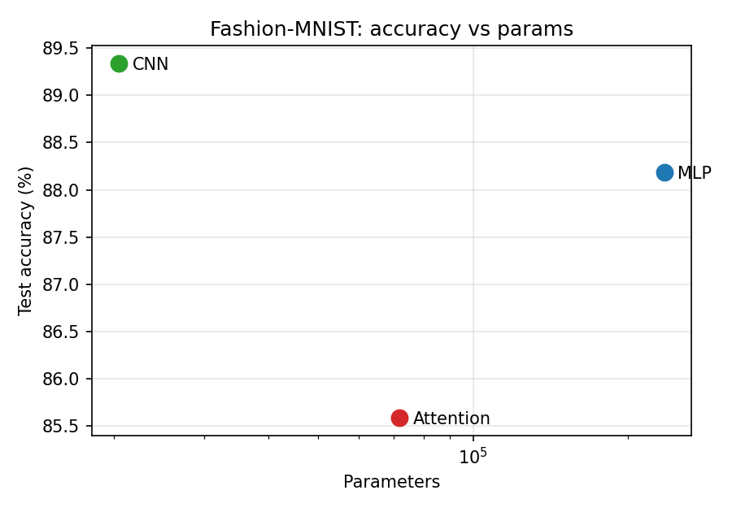
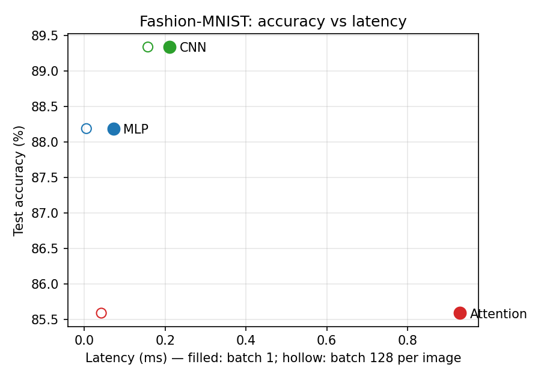

# Lab 3 — Architectures and their costs

Course: Machine Learning [CII5SE039CI], Group 02. Dataset: Fashion-MNIST.
Code: [`lab3.py`](lab3.py). Raw numbers: [`results/summary.md`](results/summary.md), [`results/results.json`](results/results.json), `results/torchinfo_*.txt`.
Handwritten calculations: [page 1](photo_3_2026-10-21_18-12-48.jpg) (shapes, parameters), [page 2](photo_2_2026-10-21_18-12-48.jpg) (one-layer FLOPs, MLP), [page 3](photo_1_2026-10-21_18-12-48.jpg) (CNN and Attention FLOPs).

## 1. Setup

- **Data:** `torchvision.datasets.FashionMNIST`, `ToTensor()` + `Normalize((0.2860,), (0.3530,))`. The official 60k train set is split into 55,000 train and 5,000 validation images (seed 42). The official 10k test set is used for testing. Batch size 128.
- **Training:** 5 epochs, Adam, lr = 1e-3, cross-entropy loss. Test accuracy is measured after epoch 5.
- **Latency protocol:** CPU (Intel Xeon @ 2.80 GHz, 2 threads), `model.eval()`, `torch.no_grad()`, 10 warm-up runs, then the median of **100** runs for batch 1 and **20** runs for batch 128, timed with `time.perf_counter()`. Software: PyTorch 2.14.1.

| Model | Architecture |
|---|---|
| MLP | Flatten 784 → Linear 256 → ReLU → Linear 128 → ReLU → Linear 10 |
| CNN | Conv(1,16,3,p=1) → ReLU → MaxPool2 → Conv(16,32,3,p=1) → ReLU → MaxPool2 → Flatten → Linear(1568,10) |
| Attention | 16 patches of 7×7 → Linear 49→64 + learnable positional embedding → 2 × TransformerEncoderLayer(d=64, h=4, ff=128) → mean pool → Linear 64→10 |

**Deviation:** I added a positional embedding (16 × 64 = 1,024 parameters). Without it, self-attention followed by mean pooling is permutation-invariant. The model could not tell where in the image a patch came from.

## 2. Parameters

`torchinfo.summary` matches the hand count exactly:

| Model | Hand count | torchinfo |
|---|---:|---:|
| MLP | 200,960 + 32,896 + 1,290 = **235,146** | 235,146 |
| CNN | 160 + 4,640 + 15,690 = **20,490** | 20,490 |
| Attention | 3,200 + 1,024 + 2 × 33,472 + 650 = **71,818** | 71,818 |

The manual asks for 100k–150k parameters, but the prescribed layers do not land in that range: the MLP is 2× above it and the CNN is 5× below. I kept the prescribed architectures so the comparison follows the specification. The 11× spread in size is part of what the results show.

## 3. FLOPs: hand calculation vs measured

Convention (Reddi, Ch. 4): 1 MAC = 2 FLOPs. Bias adds, ReLU, pooling, softmax and LayerNorm are not counted.

**One layer of each type:**

| Layer | Formula | Hand FLOPs |
|---|---|---:|
| Linear 784→256 | 2 · 784 · 256 | 401,408 |
| Conv2d(16→32, 3×3) on 14×14 | 2 · 3 · 3 · 16 · 32 · 14 · 14 | 1,806,336 |
| Transformer encoder layer (n=16, d=64, ff=128) | QKV 2·n·d·3d = 393,216; QKᵀ 2·n²·d = 32,768; A·V 2·n²·d = 32,768; W_o 2·n·d² = 131,072; FFN 2·n·d·ff·2 = 524,288 | 1,114,112 |

**Whole model, per image:**

| Model | Hand FLOPs | thop (MACs) | 2 × thop | torch `FlopCounterMode` | 2 × thop / hand |
|---|---:|---:|---:|---:|---:|
| MLP | 469,504 | 234,752 | 469,504 | 469,504 | 100 % |
| CNN | 2,063,488 | 1,031,744 | 2,063,488 | 2,063,488 | 100 % |
| Attention | 2,329,856 | 591,488 | 1,182,976 | 2,198,784 | 51 % |

**Explaining the gap:**

1. **Unit.** thop reports MACs, while the Ch. 4 formulas count FLOPs. After doubling, the MLP and CNN match the hand calculation exactly.
2. **Attention: thop misses half the work.** thop only counts modules it has a rule for. The FFN Linear layers, the patch projection and the head are counted. `nn.MultiheadAttention` has no rule, so the QKV projections, QKᵀ, A·V and W_o (1,114,112 FLOPs over two layers) count as zero. Check: 2 × 591,488 = 1,182,976 ≈ patch projection 100,352 + FFN 2 × 524,288 + head 1,280 = 1,150,208. The remaining ≈ 33k is LayerNorm and bias terms that thop counts but the hand formula does not.
3. **PyTorch's counter is closer but still 131,072 short.** `FlopCounterMode` counts every matmul, including Q, K, V and W_o. The missing 131,072 = 2 layers × (32,768 + 32,768) is exactly the n² part (QKᵀ and A·V). On CPU those run inside the fused `scaled_dot_product_attention` kernel, which the counter does not cover.

Lesson: a profiler only sees the operators it has rules for. Hand formulas are needed to sanity-check it, especially for attention and fused kernels.

## 4. Results

| Model | Params | FLOPs / img | FLOPs / param | Latency b=1 (ms) | Latency b=128 (ms) | Per image at b=128 (µs) | Activations / img | Test acc |
|---|---:|---:|---:|---:|---:|---:|---:|---:|
| MLP | 235,146 | 0.47 M | 2.0 | **0.072** | **0.68** | **5.3** | **1,562** | 88.19 % |
| CNN | **20,490** | 2.06 M | 101 | 0.211 | 20.14 | 157 | 43,914 | **89.34 %** |
| Attention | 71,818 | 2.33 M | 32 | 0.930 | 5.40 | 42 | 19,466 | 85.59 % |

Validation accuracy per epoch (MLP / CNN / Attention): epoch 1 83.3 / 86.0 / 82.0 %, epoch 5 88.1 / 89.6 / 85.8 %.





## 5. Trade-offs and the most cost-effective architecture

The answer depends on which cost is scarce. **The CNN is the most cost-effective in parameters (memory footprint).** It has the best accuracy, 89.3 %, with the fewest weights (11× fewer than the MLP). **The MLP is the most cost-effective in latency.** It gives up 1.2 pp of accuracy but is 3× faster at batch 1 and 30× faster per image at batch 128. **The Attention model is dominated:** it is less accurate than both and slower than the MLP at every batch size. The memory access primitives of Reddi §4.6–4.7 explain this pattern.

**MLP: matrix multiplication, sequential access.** Every pixel connects to every hidden unit. The weights are read sequentially, which hardware handles best (burst reads, prefetching). Each weight is used only once per image, i.e. 2 FLOPs per parameter. At batch 1 the MLP is memory-bound: its cost is reading 235k weights (≈ 0.9 MB in fp32). At batch 128 the same weights are broadcast to all 128 images (§4.7.3), so the matmul becomes one large, efficient GEMM. Per-image time then drops to 5 µs. The MLP also writes the fewest activations (1.6k per image), so its working set fits in cache. Its weakness is that it has no notion of spatial locality. Parameter storage grows as O(N × W) with input size, and accuracy per parameter is the lowest.

**CNN: sliding window, strided access.** One 3×3 kernel is shared across all positions, so each weight is reused ~100 times (101 FLOPs per parameter). Parameter storage is O(K × C), independent of image size. Locality and weight sharing are the right inductive bias for images, which gives the best accuracy from the fewest weights. The price is activation memory. The first conv writes 16 × 28 × 28 values per image, 28× more than the MLP's activations. Activation storage grows as O(B × H × W) (Table 4.3). At batch 128 that is ≈ 22 MB of activations, far beyond the CPU cache. Strided 3×3 access plus the im2col copy adds memory traffic on top. This is why the CNN is the slowest model at batch 128 (157 µs per image) despite having the fewest parameters. On a GPU or accelerator with large on-chip buffers (e.g. a TPU systolic array) this reuse is exploited much better.

**Attention: dynamic computation, gather/random access.** Weights are reused across 16 tokens (32 FLOPs per parameter). The attention weights, however, are computed at runtime from the data: each query gathers from all keys, with O(n²) activations per head. With n = 16 the n² part is only 6 % of the FLOPs, yet the model is the slowest at batch 1 (0.93 ms, 13× the MLP). A Transformer layer is many small kernels: QKV, splitting heads, QKᵀ, softmax, A·V, merging heads, two LayerNorms and the FFN. Each has launch overhead and moves small tensors with poor cache reuse, so fixed overhead dominates at batch 1. At batch 128 that overhead is amortised and it overtakes the CNN (42 µs vs 157 µs per image). In accuracy it lacks the CNN's built-in locality bias. 55k images and 5 epochs are not enough for it to learn that structure, so it is the least accurate. Its cost would grow quadratically with smaller patches (more tokens), the "problematic" scaling in Table 4.3.

**Conclusion.** For a memory-constrained deployment (e.g. a microcontroller or a model shipped to phones), the **CNN** is the best choice: highest accuracy, 80 KB of weights. For a CPU latency or throughput budget, the **MLP** gives the best accuracy per millisecond. The **Attention** model costs more than the others at this scale without an accuracy gain. Its advantage, global data-dependent mixing, only pays off with more data, longer training and hardware built for its access patterns.

## 6. Reproduce

```bash
pip install -r requirements.txt
python lab3.py              # full run: results/ and figures/
python lab3.py --epochs 1   # quick check
```
